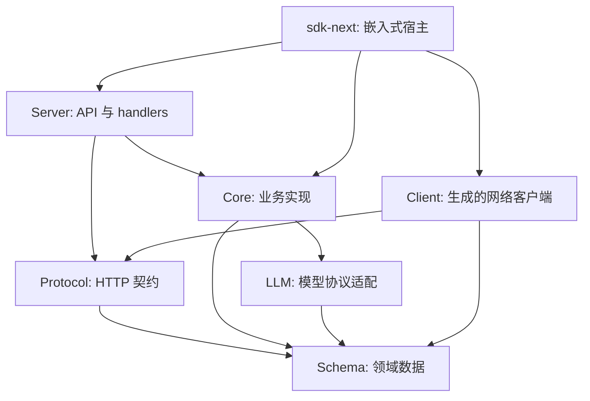
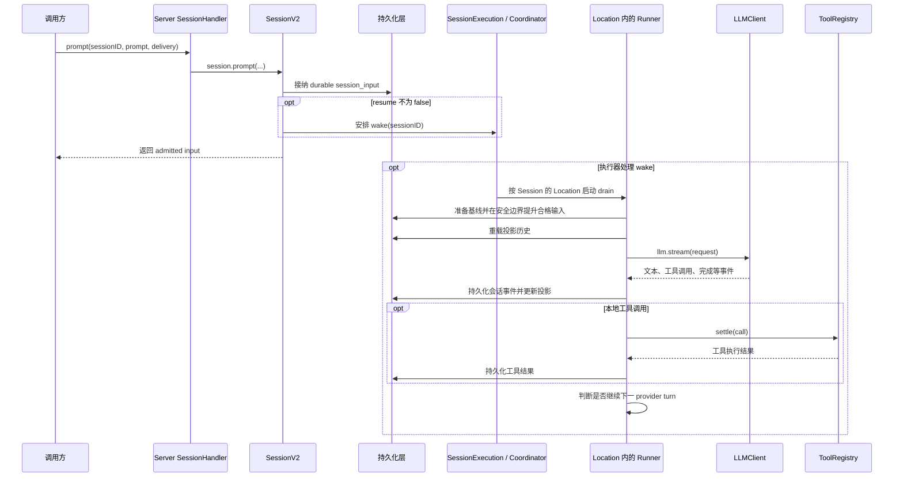

# OpenCode 项目结构与源码学习指南

> 基于当前工作区源码整理，阅读基准：`b6c460d879`，整理日期：2026-10-18。本文是源码导航，不是逐文件说明；设计文档中的计划应结合实现和测试确认。

## 1. 先建立整体认识

OpenCode 是一个 AI 编程工具。用户通过终端、Web 或桌面界面提交任务，服务端管理会话、组织模型上下文、调用模型、执行工具，并把消息和事件持续返回给界面。

这是一个 **Bun workspace + TypeScript monorepo**。同一仓库同时包含产品入口、业务核心、协议、客户端、UI、插件和部署设施。

当前源码最需要注意的是：**旧版产品集成路径与新的分层实现同时存在，而且已经互相连接。**

- 根目录 `bun dev` 仍然启动 `packages/opencode/src/index.ts`。
- 新的业务核心主要位于 `packages/core`，新的 HTTP 服务位于 `packages/server`。
- `packages/opencode` 仍有旧会话流程及兼容逻辑，同时其 HTTP 组装层已经接入新 Server 的 API 和 handlers。
- TUI 主体已在 `packages/tui`，旧产品包保留启动命令、worker 等集成代码。
- `packages/cli` 是另一套基于 Effect 的命令行入口，当前声明的可执行文件名是 `lildax`，并不是根目录 `bun dev` 的入口。

因此，学习时先确定问题属于“现有产品启动与兼容流程”还是“新的 V2 领域实现”，再沿调用链阅读。

## 2. 技术栈速查

| 技术 | 在本项目中的作用 | 可以先看哪里 |
| --- | --- | --- |
| Bun | 工作区管理、依赖安装、开发运行、测试、构建 | 根 `package.json`、`bunfig.toml` |
| TypeScript / ESM | 主要源码语言和模块组织方式 | 各包 `package.json`、`tsconfig.json` |
| Effect 4 beta | 服务依赖、资源生命周期、并发、流、错误和 HTTP API | `packages/core/src/effect/`、`packages/server/src/routes.ts` |
| Effect Schema | 数据结构、校验、编码解码、品牌类型 | `packages/schema/src/` |
| SQLite + Drizzle | 会话、事件等持久化与查询 | `packages/core/src/database/`、各领域 `sql.ts` / `*.sql.ts` |
| SolidJS | Web UI 和 TUI 的响应式组件 | `packages/app/src/app.tsx`、`packages/tui/src/app.tsx` |
| OpenTUI | 在终端渲染 Solid 组件 | `packages/tui/` |
| Vite / Electron | Web 开发构建与桌面应用宿主 | `packages/app/`、`packages/desktop/` |
| Astro / SolidStart | 内容站点和部分配套 Web 应用 | `packages/web/`、`packages/enterprise/`、`packages/console/app/` |
| Turborepo / SST | 跨包任务编排、基础设施部署 | `turbo.json`、`sst.config.ts`、`infra/` |

## 3. 根目录地图

```text
opencode/
├── packages/              产品、核心库、客户端及配套应用
├── sdks/vscode/           VS Code 扩展
├── github/                GitHub Action 集成
├── specs/                 架构方案、V2 设计、迁移说明
├── infra/                 SST 基础设施定义
├── script/                仓库级生成、发布、翻译、统计脚本
├── perf/                  性能相关材料
├── patches/               第三方依赖补丁
├── nix/                   Nix 环境相关配置
├── artifacts/             附加产物与实验材料
├── .opencode/             本仓库自身的 OpenCode 配置、命令、agent、插件等
├── .github/               CI、自动化工作流和仓库模板
├── AGENTS.md              源码修改约定与架构边界
├── CONTEXT.md             会话运行时术语和关键语义
├── CONTRIBUTING.md        开发、调试、贡献说明；部分目录说明需核对源码
├── README.zh.md           中文产品介绍
├── package.json           workspace、依赖 catalog、根开发命令
├── bun.lock               依赖锁定
├── bunfig.toml            安装策略及根目录测试保护
├── turbo.json             跨包任务配置
└── sst.config.ts           基础设施入口
```

`packages` 并非只有一层工作区。根配置还收录了 `packages/console/*`、`packages/stats/*`、`packages/sdk/js` 等嵌套包。

## 4. packages 包职责

### 4.1 学习主线：入口、业务与通信

| 目录 | 主要职责 | 学习重点 |
| --- | --- | --- |
| `packages/opencode` | 当前根开发命令启动的产品包；CLI、worker、旧业务流程、新旧服务集成 | 了解用户命令如何启动整个系统 |
| `packages/cli` | 基于 Effect 的独立 CLI；声明命令、动态加载 handler、管理 daemon | 与原 CLI 的入口和服务组装方式比较 |
| `packages/core` | V2 业务核心，另有 V1 兼容模块；会话、工具、配置、模型目录、项目、权限、数据库 | 理解 Agent 如何真正执行任务 |
| `packages/schema` | 可共享的领域数据结构与编码定义 | 先弄清 Session、Prompt、Message、Location 等是什么 |
| `packages/protocol` | HTTP endpoint、分组、错误和中间件契约 | 请求如何映射到领域能力 |
| `packages/server` | 具体 HttpApi、handlers、中间件及服务依赖组装 | 协议如何调用 Core |
| `packages/llm` | 统一模型请求、响应、事件、工具语言以及 provider/protocol/transport 适配 | 屏蔽模型供应商差异 |
| `packages/client` | 从权威 HttpApi 生成的新 Promise / Effect 客户端 | 网络调用、类型投影、生成边界 |
| `packages/sdk-next` | 同进程嵌入式宿主；组合 Client、Core、Server | 不监听端口时如何复用同一 HTTP 语义 |
| `packages/sdk/js` | 现有 `@opencode-ai/sdk`，包含生成代码和 `/v2` 导出 | 理解现有 UI、集成还在使用的客户端 |

**命名提醒：** `@opencode-ai/sdk/v2` 的路径名，不代表它就是 `packages/client` 或 `packages/sdk-next`。这几套客户端在当前仓库里并存。

### 4.2 界面与扩展

| 目录 | 主要职责 |
| --- | --- |
| `packages/tui` | 终端应用主体：组件、路由、快捷键、主题、上下文、插件 |
| `packages/app` | 共享 Web 应用：页面、会话交互、服务器连接、状态同步、设置、国际化 |
| `packages/desktop` | Electron 宿主：窗口、IPC、preload、服务进程、更新、WSL；renderer 加载共享应用 |
| `packages/ui` | 通用 UI 组件、主题、图标、样式与字体资源 |
| `packages/session-ui` | 会话领域 UI：消息、工具结果、文件、diff、输入组件等 |
| `packages/storybook` | UI 组件展示与开发环境 |
| `packages/plugin` | 插件公共契约与示例；包含 V2 Effect / Promise 两种 API |
| `packages/codemode` | 让模型编写受限 JavaScript，编排宿主显式提供的工具 |

### 4.3 基础设施与配套产品

| 目录 | 主要职责 |
| --- | --- |
| `packages/effect-drizzle-sqlite` | Effect 与 Drizzle / SQLite 的集成 |
| `packages/effect-sqlite-node` | Node 环境的 Effect SQLite 适配 |
| `packages/httpapi-codegen` | 把 HttpApi 编译为共享契约表示，分别生成 Promise / Effect 客户端 |
| `packages/http-recorder` | HTTP / WebSocket 录制回放，用于可重复的集成测试 |
| `packages/script` | 各包共享的脚本辅助代码 |
| `packages/web` | Astro 内容站点及文档相关页面；不是聊天应用 `app` |
| `packages/docs` | 另一套文档内容和文档站配置 |
| `packages/console/*` | Console 应用、业务逻辑、函数、邮件和资源等子包 |
| `packages/stats/*` | 统计相关 app、core、server 子包 |
| `packages/enterprise` | 企业及分享相关 Web 代码 |
| `packages/function` | 配套服务函数 |
| `packages/slack` | Slack 集成 |
| `packages/containers` | 容器镜像和构建环境定义 |

第一次学习建议优先阅读 4.1 和 `tui` / `app`；Console、Stats、部署与发布设施可以后置。

## 5. 分层关系与边界

下面的箭头表示“依赖或调用方向”，仅画新架构的主要关系，并非完整依赖图。



理解这张图时记住三点：

1. **Schema 描述数据，Protocol 描述通信，Core 实现业务，Server 把两者接起来。** Schema 和 Protocol 不应反向依赖服务端业务实现。
2. **Client 的运行时代码不能依赖 Core 或 Server。** 生成阶段读取 Server 的具体 API 是另一回事；`packages/client/package.json` 因而可以存在用于生成和测试的开发依赖。
3. **sdk-next 是组合层。** 它可以同时使用 Client、Core、Server，并在同进程额外开放工具注册等能力。

另外，UI 和现有产品仍处于兼容状态，不能把上图当成所有包已经完全迁移的证明。

## 6. 从启动入口读起

### 6.1 根目录 bun dev

根 `package.json` 的实际定义：

```text
bun dev
  → bun run --cwd packages/opencode --conditions=browser src/index.ts
  → packages/opencode/src/index.ts
  → yargs 注册并分派命令
```

建议按以下顺序阅读：

| 文件 | 要回答的问题 |
| --- | --- |
| `packages/opencode/src/index.ts` | 有哪些命令？公共选项、错误处理如何统一？ |
| `packages/opencode/src/cli/cmd/tui.ts` | 默认终端模式如何创建 worker、建立 RPC、启动界面？ |
| `packages/opencode/src/cli/tui/worker.ts` | worker 如何调用 Server、转发全局事件、处理关闭？ |
| `packages/tui/src/app.tsx` | 终端组件树和各 Context 如何组合？ |
| `packages/opencode/src/cli/cmd/serve.ts` | 无界面 API 服务如何启动？ |
| `packages/opencode/src/server/server.ts` | 请求 handler、HTTP listener 和资源释放如何连接？ |
| `packages/opencode/src/server/routes/instance/httpapi/server.ts` | 旧产品接口与新 Server API 在哪里组装？ |

TUI worker 提供自定义 `fetch` 的 RPC 通道，因此终端模式中的客户端调用不一定通过真实 TCP 请求。排查时要同时关注客户端、传输和服务 handler。

### 6.2 独立 CLI

```text
packages/cli/src/index.ts
  → commands/commands.ts       命令定义
  → framework/runtime.ts      参数解析、handler 分派
  → commands/handlers/*       具体命令实现
  → services/daemon.ts        后台服务与连接
```

默认 handler 位于 `commands/handlers/default.ts`，通过 daemon 获取 transport 后调用 `src/tui.ts`。`serve` handler 则直接使用 `@opencode-ai/server/routes` 创建服务。

这条路径适合在理解根开发入口之后，再比较新的服务组合方式。

## 7. Core：源码学习的重点

### 7.1 领域导航

以下路径均相对于 `packages/core/src/`。

| 路径 | 负责什么 |
| --- | --- |
| `session.ts`、`session/` | Session 公共服务、输入接纳、执行调度、消息、历史、压缩和投影 |
| `agent.ts` | Agent 定义与选择 |
| `config.ts`、`config/` | 配置加载、解析及各领域有效配置 |
| `catalog.ts`、`model.ts`、`provider.ts` | 模型目录、模型引用、供应商与配置解析 |
| `location.ts`、`location-services.ts`、`location-service-map.ts` | 执行位置及按位置构建、复用服务 |
| `project.ts`、`project/`、`workspace.ts` | 项目、目录、工作区等领域 |
| `control-plane/` | 工作区控制及会话移动等能力 |
| `tool/`、`tool-output-store.ts` | 工具契约、注册、内置工具、执行结果及超大输出存储 |
| `permission.ts`、`permission/`、`policy.ts`、`question.ts` | 授权策略、权限交互、用户提问 |
| `system-context/` | System Context 代数、注册表和内置上下文 |
| `instruction-context.ts` | 指令文件发现、加载与指令上下文生产 |
| `skill.ts`、`skill/`、`reference.ts`、`reference/` | 技能和引用的发现、描述、解析与上下文指导 |
| `plugin.ts`、`plugin/`、`integration.ts`、`integration/` | 插件生命周期与外部集成 |
| `filesystem.ts`、`filesystem/`、`file.ts` | 文件读取、搜索、监视和文件相关领域操作 |
| `snapshot.ts`、`git.ts`、`patch.ts` | 文件快照、Git 和补丁支持 |
| `pty.ts`、`pty/` | 伪终端能力及平台实现 |
| `credential.ts`、`credential/`、`oauth/` | 凭据与认证支持 |
| `event.ts`、`event/` | 事件持久化、订阅与回放 |
| `database/` | SQLite 初始化、迁移、平台实现 |
| `effect/` | 业务服务使用的依赖图、运行时和并发基础设施 |
| `v1/` | 旧接口兼容所需的领域定义和实现 |

### 7.2 V2 会话文件怎么分工

| 文件 | 阅读时关注什么 |
| --- | --- |
| `session.ts` | `SessionV2.Service` 公共能力：创建、查询、prompt、resume、interrupt 等 |
| `session/input.ts` | durable inbox：输入接纳、精确重试判断、steer / queue 提升 |
| `session/execution.ts` | 执行服务接口；把领域 API 与具体 runner 隔开 |
| `session/execution/local.ts` | 进程内实现；根据 Session 的 location 找对应服务并启动 drain |
| `session/run-coordinator.ts` | 同 Session 的串行协调、显式恢复合并和 wake 合并 |
| `session/runner/index.ts` | Runner 接口和错误类型；不是执行主体 |
| `session/runner/llm.ts` | 执行主体：准备上下文、提升输入、调用模型、处理工具、继续下一轮 |
| `session/runner/model.ts` | 解析本轮使用的模型 |
| `session/runner/to-llm-message.ts` | 持久化消息转为 LLM 输入 |
| `session/runner/publish-llm-event.ts` | 把统一 LLM 事件发布为会话事件 |
| `session/store.ts` | Session 存储读取与运行所需状态 |
| `session/projector.ts` | 将领域事件投影成可查询的 Session 状态和消息 |
| `session/history.ts` | 选择当前 provider turn 可见的历史 |
| `session/context-epoch.ts` | 持久化上下文基线、快照和 epoch 切换 |
| `session/compaction.ts` | 上下文压缩与相关继续执行逻辑 |
| `session/sql.ts` | 会话、消息、输入等数据库表 |

`session/prompt.ts` 当前主要重导出 Schema 的 Prompt 类型。要找“提交 prompt 后发生什么”，应读 **`src/session.ts` 的 `prompt` 实现**。

### 7.3 一条 V2 prompt 的调用链



安排 wake 并不等于等待模型回答；实际 drain 可以与调用方接收 admitted input 并发发生。

需要建立的几个概念：

- **接纳不等于展示给模型。** `prompt()` 先接纳 durable 输入，runner 在安全边界才将其提升为用户消息。`resume: false` 仅接纳，不安排 wake。
- **steer 与 queue 有不同的提升时机。** steer 在需要继续执行时的下一安全边界处理；queue 等会话本来要空闲时再逐条提升。
- **协调器是进程级，runner 是 Location 级。** Session ID 用于找 Session 和位置；不要把每个 Session 理解成一套独立依赖层。
- **每个 provider turn 有一次明确的 `llm.stream(request)`。** 本地工具由 Core 执行，后续 turn 重新读取投影历史。
- **drain 是进程内执行区间。** 持久化输入、事件和历史不意味着已有完整的跨进程自动续跑或集群调度。

### 7.4 System Context 与 Session History

这部分先读根目录 [CONTEXT.md](CONTEXT.md)，再对照实现：

```text
core/src/system-context/index.ts        上下文组合与状态变化的抽象
core/src/system-context/registry.ts     Location 内的上下文生产者注册表
core/src/system-context/builtins.ts     内置生产者
core/src/instruction-context.ts         指令领域提供的 Context Source
core/src/session/context-epoch.ts       Session 持有的基线和快照持久化
core/src/session/history.ts             本轮实际选用的会话历史
```

System Context 提供环境与指令；Session History 提供按当前规则选择的对话历史。Context Epoch 保存本阶段稳定的基线，变化可通过持久化的会话中途系统消息进入时间线，完成压缩或移动 Session 等操作会触发新的基线阶段。

分析“为什么模型看到了某条指令”时，应同时查看来源生产、epoch 与 history 选择，而不是只寻找一个长字符串拼接函数。

## 8. 模型、工具、事件与存储

### 8.1 模型调用

推荐沿下面的层次阅读：

```text
Core 的 Catalog / Model / SessionRunnerModel
  → packages/llm 的统一 request / message / event
  → providers/       供应商入口与认证、端点配置
  → protocols/       不同模型协议的请求和事件转换
  → route/           路由、执行、帧处理及传输
```

入口文件：`packages/llm/src/index.ts`、`packages/llm/src/llm.ts`、`packages/llm/src/route/client.ts`。供应商与协议的组织说明可参考 [LLM README](packages/llm/README.md)。

要区分“模型选什么、权限是什么”的 Core 逻辑，和“如何编码某供应商请求、解析其流事件”的 LLM 适配逻辑。

### 8.2 工具执行

建议先读一个具体工具，例如 `packages/core/src/tool/read.ts`，再读：

1. `tool/tool.ts`：工具契约。
2. `tool/builtins.ts`：内置工具如何加入运行时。
3. `tool/application-tools.ts`：宿主级工具注册。
4. `tool/registry.ts`：工具查找、定义物化、权限和执行结算。
5. `tool-output-store.ts`：模型可见输出限制与完整输出文件。
6. `session/runner/llm.ts`：模型发出 tool call 后，如何执行并进入下一轮。

不要把 `packages/opencode/src/tool/` 与 Core 的 `tool/` 当成同一目录的两个名字；它们属于并存的实现路径。

### 8.3 事件和数据库

数据库初始化及迁移由 Core 管理：

- `packages/core/src/database/database.ts`：建立服务、设置 SQLite 参数、应用迁移。
- `packages/core/src/database/sqlite.bun.ts` / `sqlite.node.ts`：通过 `#sqlite` 条件导入选择平台实现。
- `packages/core/src/database/migration/`：迁移文件。
- 各领域 `sql.ts` / `*.sql.ts`：表结构，例如 `session/sql.ts`、`event/sql.ts`。

阅读 V2 状态变化时，可以用“事件定义 → 发布和持久化 → projector → 查询视图”的顺序追踪。重点参考 `schema` 的事件定义、Core 的 `event.ts` 与 `session/projector.ts`。并非每种实时通知都是可持久化、可回放的事件，应查看对应定义。

## 9. 前端与桌面怎么读

### 9.1 Web App

```text
packages/app/src/
├── entry.tsx          浏览器入口
├── app.tsx            顶层 Providers、路由和界面组装
├── index.ts           暴露给桌面宿主等使用者的导出
├── pages/             首页、布局、新会话、会话页面等
├── components/        应用级组件
├── context/           服务器连接、SDK、同步、设置、布局等状态
├── hooks/             可复用响应式逻辑
├── utils/             协议兼容、路由、数据转换等辅助逻辑
├── i18n/              国际化
└── wsl/               WSL 服务器相关界面与状态
```

建议先追一条“页面发请求 → 收事件 → 更新 UI”的路线：

`entry.tsx` → `app.tsx` → `pages/session.tsx` / `pages/session/` → `context/server-sdk.tsx` → `context/server-sync.tsx`。

当前前端仍有旧布局、新布局以及服务器协议兼容逻辑；`utils/server.ts`、`utils/server-protocol.ts`、`utils/server-compat.ts` 能帮助解释为什么出现多套客户端类型。

分清组件层级：`ui` 放通用视觉组件，`session-ui` 放可共享的会话领域展示，`app` 负责页面与应用状态。它们的实际依赖仍需以源码为准。

### 9.2 TUI

主体位于 `packages/tui/src/`：

| 路径 | 用途 |
| --- | --- |
| `index.tsx`、`app.tsx` | 暴露 `run`、建立终端应用和 Context |
| `component/` | 提示输入、对话框和应用组件 |
| `routes/` | 终端页面与会话展示 |
| `context/sdk.tsx` | 创建 SDK、处理传输和事件接入 |
| `context/sync.tsx` | 服务端数据同步 |
| `context/route.tsx`、`context/prompt.tsx` | 路由、输入状态 |
| `keymap.tsx`、`theme/`、`ui/` | 快捷键、主题与基础终端控件 |
| `plugin/`、`feature-plugins/` | 终端插件相关能力 |

原产品包中的 `src/cli/cmd/tui.ts` 与 `src/cli/tui/worker.ts` 负责集成，不是 TUI 组件主体。

### 9.3 Desktop

当前桌面实现是 **Electron**。目录中即使保留其他历史构建材料，也应以当前包脚本和入口为准。

```text
packages/desktop/src/main/index.ts       主进程入口
packages/desktop/src/main/server.ts      服务管理
packages/desktop/src/main/sidecar.ts     配套进程支持
packages/desktop/src/main/ipc.ts         IPC
packages/desktop/src/main/windows.ts     窗口管理
packages/desktop/src/preload/            renderer 桥接
packages/desktop/src/renderer/index.tsx  渲染进程入口，组装共享 app
```

学习桌面特有能力时，再看 `main/` 的窗口、更新、系统集成和 WSL；学习聊天界面本身时优先读 `packages/app`。

## 10. Protocol、Client、SDK 和插件

### 10.1 新 HTTP 契约与生成

```text
schema/src/session.ts 等                共享领域数据
  → protocol/src/groups/session.ts      endpoint、输入输出、错误
  → protocol/src/api.ts                 API 组合工厂
  → server/src/api.ts                   注入具体中间件后的权威 API
  → server/src/handlers/session.ts      映射到 SessionV2.Service
  → client/script/build.ts              代码生成入口
```

`packages/client/src/index.ts` 是 Promise 入口，`src/effect.ts` 是 Effect 入口。生成代码分别位于 `src/generated/` 和 `src/generated-effect/`。

Promise 客户端面向结构化 wire 类型和 `fetch`；Effect 客户端保留解码后的 Schema 值及 Effect / Stream 语义。它们共享契约，但不要求对消费者暴露完全相同的值形式。

修改公开 Protocol 或 Server HttpApi 后，按根 `AGENTS.md` 在 `packages/client` 执行 `bun run generate`，不要直接修改生成目录。`httpapi-codegen` 的实现与测试适合研究“如何从契约生成 API”，首次学习业务时可跳过。

### 10.2 嵌入式 SDK

`packages/sdk-next/src/opencode.ts` 是理解依赖组合的一个好入口：

1. 创建带 Scope 的宿主与共享服务。
2. 用 `createEmbeddedRoutes()` 组装同一套 Server 路由。
3. 通过内存 transport 把请求交给 router。
4. 创建生成的 Effect Client，并增加同进程工具注册能力。
5. Scope 关闭时释放路由及相关资源。

它不需要监听网络端口，但仍经过 HTTP 编码、路由、中间件和解码边界。

### 10.3 插件

先看 `packages/plugin/src/v2/effect/README.md` 或 `v2/promise/README.md`，再看相应 `index.ts`、`plugin.ts`、`context.ts` 和各领域 hooks。

V2 插件通过上下文注册 hook，并触发相关领域 reload；Effect 与 Promise API 主要区别是异步边界表达。Core 的 `plugin.ts`、`plugin/` 负责实际加载和生命周期。

插件扩展点、模型工具和 MCP 是不同概念。研究 MCP / LSP / ACP 的现有产品接入时，可从 `packages/opencode/src/mcp/`、`src/lsp/`、`src/acp/` 开始；这些能力也会连接到共享核心或集成层。

## 11. 建议阅读顺序

### 第一轮：把系统跑通并画出主线

1. 根 `package.json`：确认 workspace 和开发入口。
2. `packages/opencode/src/index.ts`：理解 CLI 分发。
3. `cli/cmd/serve.ts` 与 `server/server.ts`：找到服务启动。
4. `packages/server/src/api.ts`、`handlers/session.ts`：找到新业务入口。
5. `packages/schema/src/session.ts`、`prompt.ts`、`session-message.ts`、`location.ts`：建立数据模型。

这一轮目标：能解释“用户从哪里输入，请求到哪里，数据是什么”。

### 第二轮：完整读懂一次 Agent 执行

1. `core/src/session.ts` 的 `prompt`。
2. `session/input.ts`。
3. `session/execution/local.ts` 与 `session/run-coordinator.ts`。
4. `location-services.ts`：理解服务作用域。
5. `session/runner/llm.ts`：先跟正常路径，再读错误、中断、压缩分支。
6. `tool/registry.ts` 与一个具体工具。
7. `session/projector.ts`、`session/history.ts`、`event.ts`。

这一轮目标：能解释“为什么先接纳输入、何时真正调用模型、工具执行后如何继续”。

### 第三轮：按兴趣深入一个方向

| 方向 | 推荐继续阅读 |
| --- | --- |
| Agent 与上下文 | `core/src/agent.ts`、`system-context/`、`session/context-epoch.ts` |
| 模型接入 | `core/src/catalog.ts`、`session/runner/model.ts`、`llm/src/providers/`、`llm/src/protocols/` |
| 工具与权限 | `core/src/tool/`、`permission.ts`、`policy.ts` |
| Web 交互 | `app/src/pages/session/`、`context/server-sdk.tsx`、`context/server-sync.tsx` |
| 终端交互 | `tui/src/app.tsx`、`component/prompt/`、`routes/` |
| 持久化与回放 | `core/src/event.ts`、`session/projector.ts`、`session/sql.ts`、`database/` |
| 客户端设计 | `protocol/`、`server/`、`client/`、`sdk-next/` |
| 现有产品兼容 | `opencode/src/session/prompt.ts`、`processor.ts`、`session.ts`、`server/routes/instance/httpapi/` |

## 12. 用测试辅助理解

测试是确认边界行为的直接材料。建议读完一个模块，就读对应测试里的场景名称和断言。

| 测试文件或目录 | 可帮助理解 |
| --- | --- |
| `packages/core/test/session-prompt.test.ts` | prompt 接纳、重试、冲突、调度边界 |
| `packages/core/test/session-run-coordinator.test.ts` | 同 Session 并发、wake 与执行协调 |
| `packages/core/test/session-runner.test.ts` | V2 执行流程 |
| `packages/core/test/session-runner-tool-registry.test.ts` | runner 与工具注册表的协作 |
| `packages/core/test/session-projector.test.ts` | 事件如何形成投影 |
| `packages/core/test/session-history.test.ts` | 当前历史选择 |
| `packages/core/test/session-compaction.test.ts` | 压缩行为 |
| `packages/core/test/system-context/` | 基线、变化和不可用上下文的语义 |
| `packages/client/test/contract-identity.test.ts` | Core / Schema 值共享、客户端与服务端契约一致性 |
| `packages/client/test/import-boundaries.test.ts` | 生成客户端的运行时依赖边界 |
| `packages/sdk-next/test/embedded.test.ts` | 同进程宿主和生成客户端如何配合 |
| `packages/opencode/test/session/` | 现有产品会话路径 |
| `packages/opencode/test/server/` | 产品级 HTTP 行为与兼容接口 |

## 13. 学习时常用命令

以下是供你本地使用的命令，本次文档整理没有启动服务、安装依赖或运行测试。仓库声明的包管理器为 `bun@1.3.14`。

```powershell
# 仓库根目录：安装依赖
bun install

# 根目录：启动当前产品 CLI/TUI，以仓库根目录作为目标目录
bun dev .

# 根目录：查看命令
bun dev --help

# 根目录：无界面服务；需要长期运行，单独开一个终端
bun dev serve --port 4096

# 另一个终端，在根目录：启动共享 Web 应用
bun run dev:web

# 根目录：桌面开发模式
bun run dev:desktop
```

类型检查和测试必须从对应包目录运行：

```powershell
# 以 Core 为例，当前目录应是仓库根目录
Set-Location packages/core
bun typecheck
bun test test/session-prompt.test.ts
bun test test/session-run-coordinator.test.ts
```

其他维护命令：

```powershell
# 当前目录应是 packages/client
bun run generate
bun run check:generated

# 当前目录应是仓库根目录：重新生成旧 JavaScript SDK
bun run ./packages/sdk/js/script/build.ts
```

`check:generated` 会重新生成并比较 Git 差异，可能写入生成文件。不要在不相关的源码学习过程中随意执行。根目录 `bun test` 被明确禁止；不要直接用 `tsc` 代替包内 `bun typecheck`。Web 的测试还有 Solid / browser 条件和 preload 要求，应使用该包声明的测试脚本。

## 14. 读源码时容易混淆的地方

- **旧文档与目录迁移：** `CONTRIBUTING.md` 中还有 TUI 位于 `packages/opencode/src/cli/cmd/tui/` 的描述。当前主体是 `packages/tui`，要以实际入口和 import 为准。
- **同名 Session：** `core/src/session.ts` 的 `SessionV2`、`core/src/v1/session.ts`、`opencode/src/session/session.ts` 不是同一个职责层。先看导入来源，再判断语义。
- **接口与实现：** `session/runner/index.ts` 定义服务，`runner/llm.ts` 实现服务；只读接口会遗漏主流程。
- **路径别名：** `@/` 是包内 `src` 的别名，例如 opencode 的 `@/session/prompt` 指向该包，不指向 Core。
- **命名空间投影：** `export * as SessionV2 from "./session"` 是模块的自重导出；消费者通过 `SessionV2.Service`、`SessionV2.node` 使用。不要据此寻找 `namespace SessionV2`。
- **Effect 阅读顺序：** `Service` 说明需要什么能力，`layer` 说明如何实现，`node` 说明依赖图如何组装，Scope 说明资源何时释放。先跟业务函数，再回头研究依赖图编译。
- **进程级与 Location 级：** 执行协调需要跨会话共享，文件、配置、权限、工具等需要按位置隔离。理解这一点后再看 `makeGlobalNode` / `makeLocationNode` 会更容易。
- **设计与现状：** `specs/v2/` 帮助理解动机，`CONTEXT.md` 定义术语；实际支持范围仍要结合源码及测试，尤其是崩溃恢复、集群与插件生命周期。

## 15. 第一条实践路线

可以从“提交一句话，模型调用 read 工具，再输出回答”作为第一个学习任务：

1. 在入口找到提交请求的位置。
2. 在 Protocol 确认请求和返回数据结构。
3. 在 Server handler 找到调用的 Core 方法。
4. 在 `SessionV2.prompt` 看输入如何持久化。
5. 在 Runner 看它何时变成模型可见消息。
6. 在 ToolRegistry 看工具如何被模型看到并执行。
7. 在 event / projector / history 看工具结果如何进入后续轮次。
8. 回到 UI 的 SDK 和同步层，看文本、工具状态如何呈现。

每一步记录“输入、输出、依赖的服务、状态写入点”，就能逐步建立完整的执行模型，而无需先通读整个仓库。
